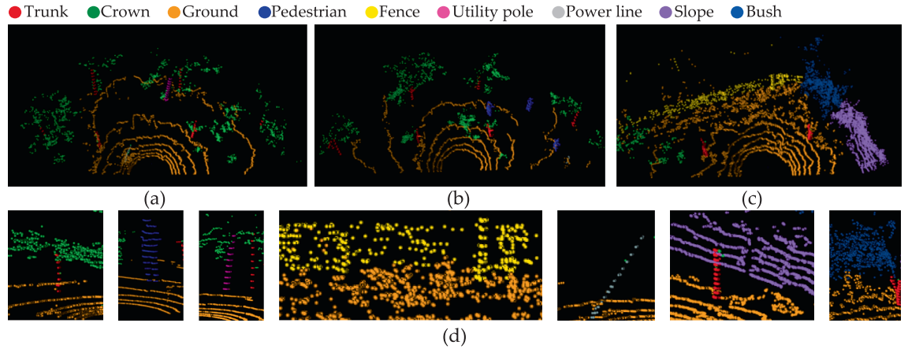
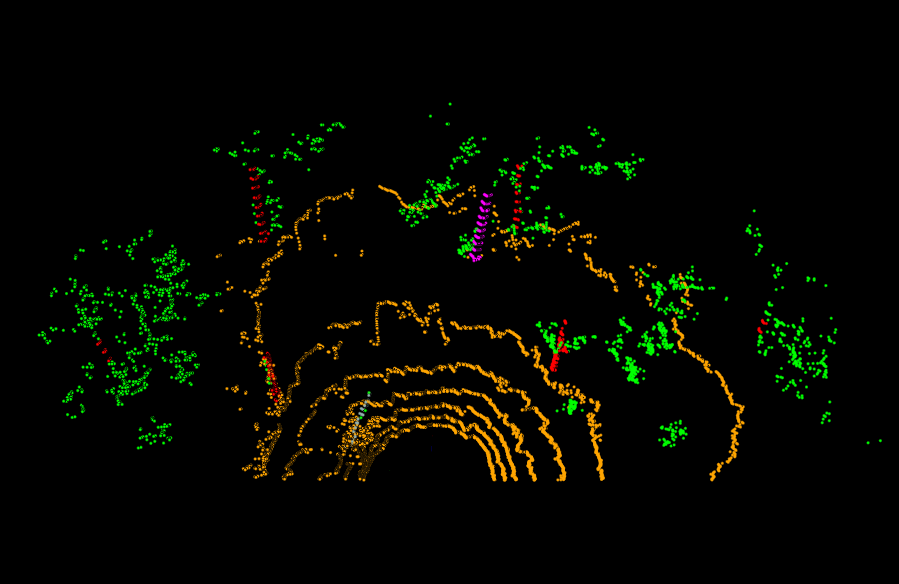
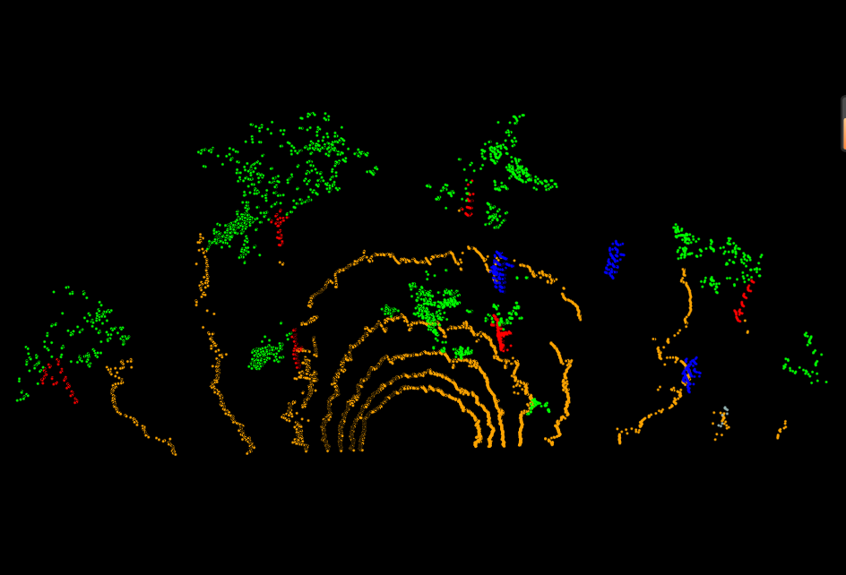
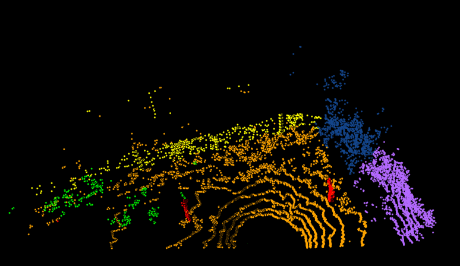

# Real-time semantic segmentation of orchard LiDAR point clouds with a spherical-image convolutional neural network

基于球面图像卷积神经网络的果园LiDAR点云实时语义分割

This repository releases the complete source code and annotated dataset for Real-time semantic segmentation of orchard LiDAR point clouds with a spherical-image convolutional neural network, supporting algorithm reproduction, benchmark evaluation and secondary development.

本仓库开源发布基于球面图像卷积神经网络的果园LiDAR点云实时语义分割的完整代码与标注数据集，可用于算法复现、基准测试与二次开发。

Different from general urban-road LiDAR datasets, this dataset is built for standard-planted orchard scenarios in China. It contains frame-by-frame fine-grained semantic annotations of 9 typical environmental elements, and can be directly applied to perception-algorithm research and benchmark testing for orchard robots.

不同于通用的城市道路点云数据集，本数据集面向我国标准化种植果园场景，包含9类典型环境要素的逐帧精细语义标注，可直接用于果园机器人感知算法研究与基准测试。

## 主要工作：

**果园九类别激光雷达点云数据集构建**

使用搭载VLP-16激光雷达的阿克曼移动机器人采集核桃果园原始点云；采用半径10 m前向半球ROI剔除遮挡与远距离无效点云；CloudCompare逐点标注9类目标：树干、树冠、地面、灌木、斜坡、电线杆、线缆、栅栏、行人；按8:1:1划分训练、验证、测试集，采用少数类帧复制、在线随机旋转数据增强。

**2、基于球面投影的非对称编-解码轻量化语义分割网络**

球面投影将无序3D点云转为5通道多模态球面图像（坐标、径向距离、回波反射率）并做通道归一化；提出Darknet26-AS非对称编码器，仅水平下采样，保留垂直分辨率；解码器采用非对称转置卷积；对数平滑加权交叉熵缓解类别不平衡；分割完成后执行球面逆投影，把图像预测标签映射回原始三维点云。

**3、图像域高斯距离加权投票边界细化后处理模块**

在球面图像二维空间做边界优化；滑动窗口选取邻域，筛选k个三维最近邻，基于欧氏距离高斯加权投票；网格搜索完成超参数调优；修正边界误分割，提升细长圆柱目标轮廓效果。

## Main Contributions：

**1. Construction of nine-class orchard LiDAR point-cloud dataset**

Raw point clouds are collected by an Ackermann mobile robot equipped with a VLP-16 LiDAR sensor. A forward-hemisphere ROI with a 10 m radius is adopted to remove occluded and distant invalid points. Nine classes (tree trunk, tree crown, ground, shrub, slope, utility pole, power line, fence and pedestrian) are annotated point-by-point using CloudCompare. The dataset is split into training, validation and test sets at a ratio of 8:1:1. Minority-class frame duplication and online random rotation are applied for data augmentation on the training set.

**2. Lightweight asymmetric encoder-decoder semantic segmentation network based on spherical projection**

Unordered 3D point clouds are projected into 5-channel multimodal spherical images (coordinates, radial range, echo reflectivity), followed by channel-wise normalization. An asymmetric encoder named Darknet26-AS is proposed, which performs down-sampling only along the horizontal direction to preserve vertical resolution. The decoder adopts asymmetric transposed convolution. Log-smoothed weighted cross-entropy loss is utilized to mitigate class imbalance. After segmentation, spherical back-projection maps predicted labels from 2D images back to the original 3D point clouds.

**3. Post-processing module for boundary refinement with Gaussian distance-weighted voting in image domain**

Boundary optimization is conducted in the 2D spherical-image space. A sliding window is used to select neighboring pixels, then k 3D nearest neighbors are filtered for Gaussian-weighted voting based on Euclidean distance. Hyper-parameters are tuned via grid-search. This module corrects mis-segmentation at object boundaries and improves contour quality for slender cylindrical targets.

## 采集场景信息 Orchard Scene Information

- 数据采集于江苏省句容市后白镇薄壳山核桃标准化种植基地（31.88°N, 119.15°E）。
- 果园采用行距6 m×株距4 m规范化密植模式；果树枝下高0.7-1.4 m，胸径10-25 cm。
- 地头两侧由栅栏、灌木构成边界；当机器人行驶到果园末行作业路径时，右侧灌木与斜坡共同构成作业区域边界。
- 场景中包含行人、电线杆、线缆、灌木、栅栏、斜坡等典型障碍物。
- 采集时间为夏季晴天下午。

Data were collected at a standardized pecan orchard in Houbai Town, Jurong, Jiangsu Province (31.88°N, 119.15°E).

The orchard adopts a dense-planting pattern with **row spacing 6 m × tree spacing 4 m**. The trunk base height ranges from 0.7-1.4 m, and diameter at breast height ranges from 10-25 cm.

Fences and shrubs form the boundaries on both sides of the orchard headland. When the robot travels along the last row path, shrubs and slopes on the right side jointly define the operation boundary.

Typical objects in this scene include pedestrians, utility poles, power lines, shrubs, fences and slopes.

Field acquisition was conducted on sunny afternoons in summer.

## 果园点云标注样例可视化：2个行间，1个地头

## 实验结果：

本模型在本开源果园LiDAR测试集上完成9类目标语义分割评估。

实验硬件环境：Intel i9-12900K+NVIDIA RTX 3090 Ti；单帧耗时包含球面投影、网络推理、边界细化、逆投影完整流程，完整实验细节请参考论文。

| 任务 | 评价指标 | 结果 |
| :--- | :--- | :--- |
| 果园9类全场景点云语义分割 | mIoU | 89.9 % |
| 果园9类全场景点云语义分割 | 单帧完整流水线推理耗时 | 12.2 ms |
| 果园9类全场景点云语义分割 | FPS | 82.0 |

模型参数量：3.8 M

各类别IoU详细结果

| 类别ID | 类别名称 | 中文 | IoU(%) |
| :-: | :--- | :--- | ---: |
| 1 | tree_trunk | 树干 | 82.9 |
| 2 | pedestrian | 人员 | 95.3 |
| 3 | pole | 电线杆 | 89.1 |
| 4 | pole_cable | 线缆 | 74.2 |
| 5 | fence | 栅栏 | 78.5 |
| 6 | slope | 斜坡 | 97.8 |
| 7 | shrub | 灌木 | 95.5 |
| 8 | ground | 地面 | 98.8 |
| 9 | crown | 树冠 | 97.1 |

## Experimental Results：

The proposed model is evaluated for 9-class semantic segmentation on the open-source orchard LiDAR test set.

Hardware configuration: Intel i9-12900K+NVIDIA RTX 3090 Ti. The per-frame latency covers the full pipeline including spherical projection, network inference, boundary refinement and back-projection. Please refer to the paper for full experimental details.

| Task | Metric | Result |
| :--- | :--- | :--- |
| Orchard 9-class full-scene point cloud semantic segmentation | mIoU | 89.9 % |
| Orchard 9-class full-scene point cloud semantic segmentation | End-to-end per-frame pipeline latency | 12.2 ms |
| Orchard 9-class full-scene point cloud semantic segmentation | FPS | 82.0 |

Model parameters: 3.8 M

Per-class IoU results

| Class ID | Class Name | IoU(%) |
| :-: | :--- | ---: |
| 1 | tree_trunk | 82.9 |
| 2 | pedestrian | 95.3 |
| 3 | pole | 89.1 |
| 4 | pole_cable | 74.2 |
| 5 | fence | 78.5 |
| 6 | slope | 97.8 |
| 7 | shrub | 95.5 |
| 8 | ground | 98.8 |
| 9 | crown | 97.1 |

## 引用方式：

[1]. Li Q\*, Jing S. Real-time semantic segmentation of orchard LiDAR point clouds with a spherical-image convolutional neural network[J/OL]. Computers and Electronics in Agriculture, 2027, 258: 112634. https://doi.org/10.1016/j.compag.2026.112634.
